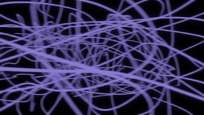
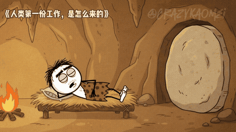
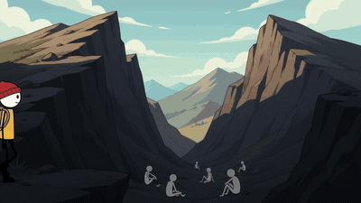
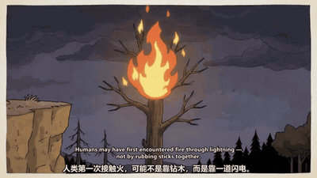
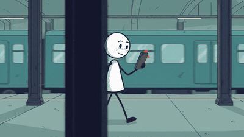

<!-- readme:hero -->

<div align="center">

[**简体中文**](README.zh-CN.md) · [English](README.en.md) · [日本語](README.ja.md) · [한국어](README.ko.md) · [Português do Brasil](README.pt-BR.md)

# AI 火柴人动画画风大全

**将任何想法变成一部高质量的、稳定画风火柴人视频。**

[](https://github.com/kaomei/stickman-video-director/stargazers)


</div>

<div align="center">

我把全网所有热门的火柴人画风，逐个实测并整理开源出来。安装好 Skill 后，你只需要给一个话题，就能拿到动画脚本、动态分镜，以及配音和音效提示词。

<strong>以后想做火柴人动画，来这里挑画风就够了——</strong>适用于 **YouTube 知识讲解、TikTok、职场励志、教育科普和快节奏情感故事。**

</div>

<table width="100%">
<tr>
<td width="50%" align="center">
<strong>黑白极简</strong><br>
<a href="#style-gallery"></a>
</td>
<td width="50%" align="center">
<strong>潮酷科技</strong><br>
<a href="#style-gallery"></a>
</td>
</tr>
<tr>
<td width="50%" align="center">
<strong>史前黑色幽默</strong><br>
<a href="#style-gallery"></a>
</td>
<td width="50%" align="center">
<strong>治愈故事</strong><br>
<a href="#style-gallery"></a>
</td>
</tr>
</table>

<div align="center">

**4 大画风 · 6 种视觉方案 · 实测样片 · 免费开源**

⭐ **先收藏，下次做火柴人动画不用再到处找提示词。**

[开始使用](#quick-start) · [最近更新](#recent-updates) · [完整制作教程](https://x.com/CrazyKaomei/status/2102311241046008268)

</div>

<!-- readme:demos -->

<a id="style-gallery"></a>

## 全部画风一览

### 风格 1：基础黑白风

用最少的线条，把一个概念讲清楚。纯白或纯黑的画布上，人物、道具和强调色承担主要信息，适合做节奏明快的知识解说。

- **画面特点**：简洁圆头、线条肢体与统一线宽，可偶尔加入简单表情；最多三种高饱和强调色，用来区分情绪、风险或行动。抽象内容可以变成具体画面，比如把焦虑画成牢笼，把注意力画成进度条。
- **适合内容**：科学常识、心理成长、励志、自我管理、商业拆解与概念解释。
- **怎么选**：白底黑火柴人清爽直观，适合教学和日常科普；黑底白火柴人对比更强，适合悬念、冲突和情绪表达。

| 风格 1A：白底黑火柴人 | 风格 1B：黑底白火柴人 |
|:---:|:---:|
| <!-- demo:light:start --><!-- demo:light:end --> | <!-- demo:dark:start --><!-- demo:dark:end --> |
| 纯白画布 · 黑色人物 | 纯黑画布 · 白色人物 |

---

### 风格 2：现代潮酷风

红色冷帽、黄色 T 恤，是这套画风最鲜明的角色标记。既可以在干净的科技空间里讲产品，也可以走进卧室、街道和荒野，演一段有起伏的故事。

- **画面特点**：固定红帽黄衣的极简角色，搭配两种环境。2A 用纯白空间、极淡网格、悬浮玻璃界面和青蓝光效表现科技感；2B 用彩色场景、光影和空间纵深营造故事氛围。
- **适合内容**：2A 适合 AI 工具、科技产品、方法教学与功能解说；2B 适合成长经历、生活话题、冒险与励志故事。
- **怎么选**：重点是“讲清一个工具或方法”，选 2A；重点是“跟着角色经历一件事”，选 2B。

| 风格 2A：极简科技 | 风格 2B：彩色故事 |
|:---:|:---:|
|  |  |
| 纯白空间 · 极淡网格 · 青蓝微光 | 彩色场景 · 电影光影 · 叙事氛围 |

---

### 风格 3：史前手绘 / 黑色幽默

把今天的烦恼，搬回没有手机和办公室的史前世界。洞穴、兽皮、篝火和夸张表情，让职场、人性与生活里的荒诞，变成一段带反转的小故事。

- **画面特点**：粗手绘线条、白色实心头部、深色肢体、兽皮服饰和土色环境，强调角色互动、表情反应与喜剧停顿。角色按故事设计，男女老幼都可以出现，不同故事不必共用一张脸。
- **适合内容**：史前脑洞、职场讽刺、人性观察、黑色幽默、寓言与儿童英语故事。
- **怎么选**：想用一个小情节讲出“原来如此”或“怎么会这样”的反转，可以选这一风格；尤其适合把现代关系放进原始部落，做出熟悉又意外的笑点。

| 案例 1：《人类的第一份工作是怎么来的？》 | 案例 2：《人类第一次发现火源》 |
|:---:|:---:|
|  |  |
| 史前故事 · 职场反转 | 火源主题 · 粉丝作品 |

---

### 风格 4：治愈故事风

一只舍不得用的杯子，一条忍不住秒回的消息，一个终于留给自己的下午。让极简角色走进彩色的日常场景，用动作、表情和镜头讲普通人能共鸣的小事。

- **画面特点**：白色实心圆头与细长躯干、深色细肢体和自然的小表情，搭配完整的 2D 卡通环境。全景交代地点，近景捕捉犹豫或释然，跟拍带着角色继续向前。
- **适合内容**：生活共鸣、心理成长、人际关系、温暖故事、习惯养成与儿童英语。
- **怎么选**：想让观众从一个具体生活片段里认出自己，可以选这一风格。色彩和光影随主题变化，既能表达温暖，也能讲焦虑、疲惫和重新出发。

| 案例 1：通勤路上的消息焦虑 | 案例 2：把时间留给自己 |
|:---:|:---:|
|  |  |
| 地铁站 · 行走跟拍 · 情绪近景 | 露天咖啡座 · 暖光树影 · 日常动作 |

<!-- readme:advantages -->

## 它帮你做什么

把选题、脚本和画面一起考虑，不只是给火柴人套一个外观。

| 环节 | Skill 输出 |
|---|---|
| **文案** | 开场、递进、结尾，英文旁白与中文参考。 |
| **画面** | 动作、道具、运镜、转场与音效。 |
| **衔接** | 人物、道具与声线设定，跨段转场。 |
| **画幅** | 按横竖屏调整构图和镜头。 |
| **调整** | 先确认提案，再输出提示词。 |

<!-- readme:output -->

先拿到**导演提案**：英文旁白、中文参考、场景、运镜和声音设计。确认后再拿到逐段独立的 **Gemini Omni Flash 视频提示词**，以及转场、拼接与字幕建议。

Skill 负责提案和提示词，Flow 等工具负责生成视频，最后用剪映等软件完成字幕与剪辑。无需为 Skill 配置 API 或 MCP。

<!-- readme:install -->

<a id="quick-start"></a>

## 开始使用

### 1. 安装 Skill

把下面这句话发给你使用的 AI：

```text
帮我安装这个 Skill：
https://github.com/kaomei/stickman-video-director
```

<!-- readme:workflow -->

### 2. 给一个话题

安装后，把话题、文案或文章直接发给 AI，例如：

```text
帮我做一个《人类的第一份工作是怎么来的？》的火柴人视频。
```

### 3. 跟着引导，确认提案

**选设置 → 看导演提案 → 按需修改 → 确认后拿提示词。**

画幅、画风没选，Skill 会主动询问；时长可指定，默认 60 秒。你只要跟着引导，选横屏 `16:9` 或竖屏 `9:16`，再从上面的画风中选一种即可；已经提供的设置不会重复询问。想先试一小段，也可以直接说“先做 30 秒”。

选好设置后，它会先给你导演提案，列出故事结构、分段旁白、画面动作、镜头和声音设计。你可以先看整体方案，修改不满意的部分，确认后再拿到用于生成视频的分段提示词。

**《人类的第一份工作是怎么来的？》｜横屏 16:9 · 风格 3 史前黑色幽默 · 30 秒**

下面是这支样片制作前确认的分镜提案：

| 时间 | 画面与动作 | 配音文案 |
|---|---|---|
| **0–10s：拒绝生存压力** | 原始人拖着石棒回到洞穴，瘫倒在草床上。洞口出现剑齿虎的巨大影子。他睁开一只眼，一脸“又来？”；起身滚动巨石堵住洞口，拍掉手上的灰，回床睡觉。最后定格在他满意的脸上。 | **“Ten thousand years ago, one man finally solved all his problems. He shut them outside.”** |
| **10–20s：老板找到你了** | 接上一段：他刚闭眼，洞口传来三声敲击。巨石被推开一条缝，族长探头进来，笑着递给他一根长矛。他摆手拒绝。族长随即拿出一条烤肉腿；他的鼻子抽动，眼睛瞬间睁大。切到洞外：他已经握着长矛，被族长推向猛兽脚印。 | **“Then someone offered him food… in exchange for a small favor. Congratulations. Employment was invented.”** |
| **20–30s：文明的代价** | 他满身灰尘回到同一个洞穴，把长矛扔下，伸手等烤肉。族长面带职业微笑，只递给他一小块肉；然后把一大捆长矛塞进他怀里，拍拍他的肩膀离开。他看着小肉块，再看长矛，缓缓转头直视镜头。最后躺回草床，却被怀里的长矛硌得坐起来。 | **“The reward got smaller. The workload got bigger. And somehow… they called that progress.”** |

提案不满意，直接说要改哪里；你确认后，它才输出最终分段提示词。这个 30 秒示例对应 3 条约 10 秒的提示词，包含人物、动作、镜头、旁白和声音要求。

### 4. 生成视频，剪辑成片

将提示词按顺序提交到 [Google Flow](https://flow.google.com/)，再把生成片段导入剪映，调整衔接并添加字幕。30 秒通常对应 3 条约 10 秒的提示词，60 秒对应 6 条。

第一次做，跟着这篇[完整制作教程：选题、脚本、Flow 生成与剪映成片](https://x.com/CrazyKaomei/status/2102311241046008268)跑一遍。Flow 操作见[使用教程](https://x.com/CrazyKaomei/status/2093893997223923822?s=20)。Skill 免费开源，视频生成费用和可选模型以平台当前界面为准。

<!-- readme:reliability -->

## 使用小贴士

<!-- readme:platforms -->

**选横屏还是竖屏？**

| 比例 | 适合平台 | 构图重点 |
|---|---|---|
| `9:16` | YouTube Shorts、TikTok、Instagram Reels、抖音、小红书 | 纵向动作、中央主体、手机画面安全区 |
| `16:9` | YouTube、B 站、横屏教育视频 | 横向调度、场景展开、左右对比 |

适合不露脸的知识解说、历史商业科普、心理成长、生活故事和产品讲解；英文旁白配后期双语字幕，也能做儿童英语、生活短剧或知识精读。支持 30 秒、60 秒、90 秒、3 分钟等 10 秒整数倍时长。

- 人物、道具和旁白设定按整支视频统一；需要换声音时，先在提案里确定。
- 发现某段人物、道具或声音明显偏离时，针对该段调整和复测，不用重做所有片段。
- 文案可以改得更有吸引力，但不凭空添加事实、数据或产品效果。

<a id="recent-updates"></a>

## 最近更新

- **2026-10-15**：优化中文首页、安装入口和案例说明，加入轻量动图预览与 Star 增长曲线；Skill 规则不变。
- **2026-10-14**：新增风格 4「治愈故事风」，加入地铁站与咖啡座两个样片。
- **2026-10-13**：优化风格 1 的人物描述与当前姿态约束。
- **2026-10-12**：完善全风格共用的语音一致性规则，补充史前风格案例。

已有用户：最近的首页调整不需要重装。想用风格 4，或安装的是人物／声音规则更新前的版本，再更新 Skill 即可。[查看更新记录](CHANGELOG.zh-CN.md)。

<!-- readme:contribute -->

## 下一种火柴人，你来点

下面这些画风正在计划中，尚未上线：

- **虚实融合场景** — 继续探索 2D 火柴人与更丰富环境的搭配。
- **风格 5：讲台解说** — 黑板互动与知识讲解。
- **风格 6：手绘绘本** — 童话、寓言与儿童故事。
- **风格 7：涂鸦打斗** — 动作短片与连招对决。
- **风格 8：双人情景喜剧** — 对话、互怼与日常反转。
- **风格 9：卡牌闯关** — 升级、打怪与游戏叙事。

想看新画风、分享作品或反馈问题，都欢迎到 [Issues](https://github.com/kaomei/stickman-video-director/issues) 留言。画风建议请附参考和想做的主题；投稿请附作品、所用风格与作者链接，方便展示和署名。

## Star 增长曲线

⭐ **如果这份画风库帮你省下了找提示词、反复试错的时间，欢迎点个 Star，留着下次做动画时用。**

我是[烤妹儿](https://x.com/CrazyKaomei)，会继续实测新画风，把好用的提示词、制作方法和踩过的坑免费整理在这里。希望你少花时间折腾工具，多留一点时间给真正想讲的故事。

<div align="center">
<a href="https://www.star-history.com/?repos=kaomei%2Fstickman-video-director&amp;type=date">
  <picture>
    <source media="(prefers-color-scheme: dark)" srcset="https://api.star-history.com/svg?repos=kaomei/stickman-video-director&amp;type=Date&amp;theme=dark">
    <source media="(prefers-color-scheme: light)" srcset="https://api.star-history.com/svg?repos=kaomei/stickman-video-director&amp;type=Date">
    
  </picture>
</a>
</div>

## 许可证

本项目采用 [MIT License](LICENSE) 开源，允许免费使用、修改、商用和分发。分发本项目或其重要部分时，请保留原有版权和许可声明。

项目按“现状”提供，不作任何担保；完整条款见 [LICENSE](LICENSE)。
